# SOFTWARE ENGINEERING LAB
## ALL LAB ASSIGNMENTS
**NAME – AGNIVA SARDAR**  
**REGISTER NO – 24BPS1125**  

---

# LAB 1
**Agniva Sardar**  
**24BPS1125**  
**Software Engineering Lab**  
**Exercise 1**  

### Crack My DSA: Company-Wise DSA RAG & Interview Preparation Platform

## 1.0 INTRODUCTION

### 1.1 PURPOSE
The purpose of this project is to build an intelligent, production-grade Data Structures & Algorithms learning and interview preparation platform named **Crack My DSA** (CodePrep AI). Software engineering candidates preparing for top tech enterprises (Google, Meta, Amazon, Microsoft, Netflix, Apple, Uber) often struggle to bridge the gap between static problem sheets and real-world company-wise interview frequency analytics. The purpose of this Software Requirements Specification (SRS) is to establish a rigorous, clear, and unambiguous definition of the platform's features, functional behaviors, RAG pipeline architecture, and constraints so that all developers, evaluators, and stakeholders understand what to build and why.

### 1.2 INTENDED AUDIENCE
This system is intended for computer science students, competitive programmers, job applicants, technical interview coaches, and system evaluators. Learners interact with the system via a modern web interface to query interview frequency trends, practice curated roadmaps, execute multi-language code solutions, and track problem-solving statistics.

### 1.3 SCOPE AND OBJECTIVE
The scope of this system encompasses natural language query processing, dense vector retrieval over company-wise LeetCode metadata, generative LLM synthesis with Google Gemini, full integration of the Strivers A2Z DSA Sheet (16 core modules), multi-language code execution sandboxing, private doubt resolution, and bi-directional LeetCode profile synchronization. The system incorporates both an intuitive React 18 single-page application frontend and a robust FastAPI Python backend.

**The main objectives of the system are:**
- To provide instant semantic search and contextual AI guidance over thousands of company-wise LeetCode interview questions.
- To decouple dense vector similarity matching (ChromaDB) from answer generation (Google Gemini 1.5 Pro) through a modular RAG pipeline.
- To offer a structured 16-module algorithmic curriculum (Strivers A2Z DSA Sheet) complete with theory guides, visual diagrams, and multi-language solutions (C++, Java, Python).
- To deliver safe multi-language code execution with real-time test-case validation.
- To support both instant frictionless Guest Mode and persistent Supabase PostgreSQL authentication with profile synchronization.

### 1.4 DEFINITIONS, ACRONYMS AND REFERENCES
The table below defines the terminology, acronyms, and technologies used throughout this document:

| Term / Acronym | Meaning & Technical Definition |
| :--- | :--- |
| **RAG** | Retrieval-Augmented Generation: An AI framework that enhances LLM generation by retrieving relevant domain knowledge from an external vector database. |
| **ChromaDB** | An open-source, high-performance embedded vector database used to store and query dense 768-dimensional document embeddings. |
| **Gemini 1.5 Pro / Flash** | Google's state-of-the-art multimodal large language models utilized for natural language query synthesis, code explanations, and private doubt clearing. |
| **text-embedding-004** | Google Gemini's high-efficiency embedding model used to transform problem text and metadata into normalized 768-dimensional vector representations. |
| **FastAPI** | Modern, asynchronous high-performance web framework for building REST APIs with Python 3.10+. |
| **React 18 / Vite 5** | Component-driven frontend library and lightning-fast build tool used for rendering the responsive, glassmorphic Single Page Application (SPA). |
| **Supabase PostgreSQL** | Cloud-hosted relational database providing Row Level Security (RLS), user authentication, chat session persistence, and solved problem logging. |
| **Strivers A2Z DSA Sheet** | A structured, 16-module algorithmic syllabus covering fundamental to advanced computer science topics, curated by TakeUForward. |
| **Code Sandbox Runner** | An isolated backend subprocess execution engine that securely compiles and runs user code in C++, Java, and Python with execution timeouts. |
| **JWT (JSON Web Token)** | Cryptographic token used to securely transmit claims and authenticate user sessions between the frontend client and backend services. |

---

## 2.0 OVERALL DESCRIPTION

### 2.1 PRODUCT PERSPECTIVE AND FEATURES
Crack My DSA is a comprehensive educational platform that unifies real-world interview analytics with structured algorithmic study. It acts as a 24/7 personal technical interview tutor that understands specific company hiring trends, solves doubts with granular line-by-line code breakdowns, and records practice progress.

**The Features include:**
- **Natural Language Company & Topic Search:** Ask questions like *"Show top 10 dynamic programming questions asked at Google in the last 6 months"* and receive precise citations with difficulty and frequency rankings.
- **Interactive Chat with RAG Context:** Synthesizes structured markdown explanations, edge cases, algorithmic intuition, and LaTeX-formatted time/space complexities ($O(N)$, $O(\log N)$).
- **Dual Authentication & Session Persistence:** Supports instant Guest Mode (localStorage) and Supabase cloud accounts with automatic session migration.
- **Strivers A2Z DSA Roadmap:** Interactive 16-module curriculum covering 400+ curated problems, detailed theory guides, curated YouTube links, and multi-language solutions (C++, Java, Python).
- **Multi-Language Code Runner Sandbox:** In-browser code editing and execution for C++, Java, and Python with sample and hidden test case evaluation.
- **Private AI Doubt Solver:** Contextual doubt assistance under any specific problem (e.g., *"Why use two pointers instead of dynamic programming here?"*).
- **LeetCode Profile Sync & Analytics:** Synchronizes solved problem statistics via LeetCode's public GraphQL API, showing Easy/Medium/Hard distribution and paginated problem logs.
- **Guided 9-Step Onboarding Tour:** Interactive product walkthrough for first-time visitors.

### 2.2 USER CHARACTERISTICS
- **Learners / Job Candidates:** Software engineering students and professionals preparing for technical interviews. They interact with the web interface to query interview patterns, practice problems, and execute code without needing to understand backend vector mechanics.
- **Guest Users:** Casual visitors exploring the platform without logging in. Their progress and sessions are preserved in browser storage.
- **Developers & System Administrators:** Technical maintainers who manage data scraping, embedding re-indexing, server health, and API integrations.

### CONSTRAINTS AND ASSUMPTIONS
**CONSTRAINTS:**
- The backend requires Python 3.10+ runtime and dependencies including FastAPI, ChromaDB, and google-generativeai.
- Active Internet connectivity is required to communicate with Google Gemini API, Supabase PostgreSQL, and LeetCode GraphQL endpoints.
- Code execution sandbox applies strict timeouts (maximum 5 seconds) to prevent infinite loops and denial-of-service vulnerabilities.
- Google Gemini API rate limits (requests per minute) must be observed during peak batch embedding generation.

**ASSUMPTIONS:**
- Users possess a modern web browser supporting ES6 JavaScript, Web Storage, and CSS Flexbox/Grid.
- Problem metadata and company-wise frequency percentages scraped from LeetCode remain representative of current interview patterns.
- Users requesting LeetCode synchronization provide a valid, publicly visible LeetCode username.

### SYSTEM ENVIRONMENT AND DEPENDENCIES
| Component | Technical Specification / Details |
| :--- | :--- |
| **Client Runtime** | Web Browser (Chrome 90+, Firefox 88+, Safari 14+, Edge 90+) |
| **Frontend Framework** | React 18.2, Vite 5.0, Tailwind CSS / Vanilla CSS Glassmorphism |
| **Backend Server** | Python 3.10+, FastAPI 0.109+, Uvicorn ASGI Server |
| **Vector Database** | ChromaDB (Persistent vector index in `vectorstore/chroma_db`) |
| **Generative AI & LLM** | Google Gemini 1.5 Pro / Flash via `google-generativeai` SDK |
| **Embedding Model** | Google `text-embedding-004` (768-dimensional normalized embeddings) |
| **Relational Database** | Supabase Managed PostgreSQL 15 with Row Level Security |
| **Third-Party APIs** | LeetCode Public GraphQL Endpoint, YouTube Video Embedding |
| **Hosting & Deployment** | Vercel (Frontend SPA), AWS EC2 / Render (Backend API) |

---

## 3. FUNCTIONAL REQUIREMENTS

### DETAILED DESCRIPTION OF SYSTEM BEHAVIOUR
- **User Registration:** Allows users to create accounts using email, full name, and password; passwords are protected by cryptographic hashing (Supabase Auth).
- **User Login:** Authenticates credentials and returns a secure JWT access token and user metadata.
- **Guest Access:** Zero-friction guest experience with local persistence of state and session history.
- **RAG Search Querying:** Parses natural language queries, identifies company and DSA topic filters, generates query embeddings, and performs vector cosine similarity matching.
- **Answer Synthesis & Citations:** Generates step-by-step markdown explanations, time/space complexities, and displays verified reference problem cards with external links.
- **Strivers A2Z Roadmap Browsing:** Categorizes 400+ problems across 16 core DSA modules, offering theory explanations, video links, and multi-language code snippets.
- **Code Execution Sandbox:** Compiles and runs user-submitted C++, Java, and Python programs against custom input and public test cases under execution limits.
- **Private AI Doubt Clearing:** Generates contextual, private line-by-line code explanations for user doubts on any specific problem.
- **LeetCode Profile Sync:** Fetches user statistics and recent submissions from LeetCode GraphQL API to automatically update solved statuses.
- **Session History Management:** Persists and reloads multi-turn conversations across browser refreshes and user logins.

### INPUT AND OUTPUT PROCESSING RULES
| Feature | Input Parameters | Processing Logic / Validation Rules | Output Produced |
| :--- | :--- | :--- | :--- |
| **User Registration** | Name, Email, Password | Validate email format; ensure password length >= 6; hash password securely via Supabase Auth. | User account record, JWT access token, user profile. |
| **User Login** | Email, Password | Verify credentials against stored hash in Supabase; check account status. | Authenticated session token, user metadata, sync history. |
| **RAG Query Assistant** | Query text, Target Company, Topic, Difficulty, History | Extract filter entities; generate query vector via `text-embedding-004`; perform cosine similarity search in ChromaDB; synthesize answer with Gemini 1.5 Pro. | Markdown answer with LaTeX equations and structured reference problem cards. |
| **Exclude Solved Search** | Query text + 'unsolved'/'fresh' keywords, user_email | Retrieve user solved problem IDs; exclude matching problem IDs from ChromaDB candidate set. | Curated list of unseen company problems matching query. |
| **Roadmap Topic Practice** | Topic ID, Language Selection (C++/Java/Python) | Fetch module details from `strivers_a2z_sheet.json`; retrieve language-specific solution. | Rendered theory guide, video tutorial link, and syntax-highlighted code. |
| **Run User Code** | Language, Source code string, STDIN input | Write code to sandbox file; execute subprocess under 5s timeout; capture stdout and stderr. | Execution status ('Success'/'Runtime Error'), stdout, execution time. |
| **Ask AI Doubt** | Problem title, Code context, Doubt text | Construct pedagogical prompt combining problem context with doubt; query Gemini LLM. | Granular step-by-step doubt explanation saved to user history. |
| **Sync LeetCode Profile** | LeetCode username, user_email | Query LeetCode GraphQL endpoint; parse submission statistics; update database profile. | Updated Total, Easy, Medium, Hard solved counts and paginated solved questions table. |

### USE CASES
- As a job seeker, I want to search for top questions asked by Microsoft in the last 6 months so that I can focus on high-frequency interview topics.
- As a student, I want to learn Dynamic Programming step-by-step through Strivers A2Z Sheet so that I master the core concepts with video tutorials.
- As a candidate, I want to view solutions in C++, Java, and Python so that I can practice in my preferred programming language.
- As a learner, I want to ask why a specific line of code is needed in a solution so that I can clear my algorithmic doubts instantly.
- As a programmer, I want to test my solution code against test cases inside the platform without switching tabs.
- As a user, I want to sync my LeetCode profile so that my solved problems are automatically recognized and excluded from future query suggestions.
- As a guest user, I want to try out the platform immediately without filling out a sign-up form.

---

## 4. NON-FUNCTIONAL REQUIREMENTS

### 4.1 PERFORMANCE, RELIABILITY AND SCALABILITY
- **Performance:** Vector retrieval operations in ChromaDB complete within 150 milliseconds. LLM generation streams responses with initial token delivery in under 1.5 seconds under standard broadband connections.
- **Reliability:** The backend provides an automatic fallback mechanism: if ChromaDB is unavailable, the system smoothly falls back to keyword-indexed metadata search across cleaned CSV files.
- **Scalability:** The FastAPI backend is stateless and horizontally scalable across containerized instances. Vector indices are stored persistently on disk, and Supabase manages database connection pooling.

### 4.2 SECURITY, USABILITY AND MAINTAINABILITY
- **Security:** User passwords are encrypted using modern cryptographic hashing. All API communications require HTTPS encryption. Code execution occurs within an isolated subprocess environment with strict resource limits.
- **Usability:** Responsive glassmorphic interface designed for both mobile screens (<= 768px) and desktop displays. Includes dark mode, one-click code copying, and LaTeX KaTeX math formula rendering.
- **Maintainability:** Modular directory layout cleanly separating `api/`, `rag/`, `embeddings/`, `vectorstore/`, `services/`, and `frontend_react/`.

### 4.3 COMPLIANCE AND REGULATORY REQUIREMENTS
The application adheres to standard data privacy practices. User email addresses and passwords are never logged in plain text. All third-party data accessed via LeetCode's public GraphQL API complies with public data access guidelines.

---

## 5. EXTERNAL INTERFACE REQUIREMENTS

### 5.1 USER INTERFACES
The user interface is built using React 18, Vite 5, and modern Glassmorphic styling. It features an expandable sidebar with chat session history, a main chat query area with Markdown syntax highlighting, a 16-module Strivers A2Z DSA Sheet explorer, a collapsible Reference Panel for problem cards and YouTube videos, and an Analytics Dashboard with paginated solved logs.

### 5.2 APIS
| Method | Endpoint | Purpose |
| :--- | :--- | :--- |
| **GET** | `/` or `/api` | Root health check returning server and database connectivity status. |
| **POST** | `/api/query` | Submit natural language RAG query; returns synthesized answer and reference problems. |
| **GET** | `/api/metadata` | Retrieve available companies, topics, and company-topic mapping lists. |
| **GET** | `/api/stats` | Fetch vector database statistics (total indexed questions, dimensions). |
| **POST** | `/api/users` | Register or fetch user profile by email and password. |
| **GET** | `/api/users/{email}/sessions` | Retrieve all persisted chat conversation sessions for a user. |
| **POST** | `/api/sessions` | Save or update a chat session, messages, and retrieved references. |
| **DELETE** | `/api/sessions/{session_id}` | Delete a chat conversation thread. |
| **GET** | `/api/users/{email}/solved` | Get list of problems marked as solved by the user. |
| **POST** | `/api/users/{email}/solved` | Toggle solved status of a specific problem. |
| **POST** | `/api/users/{email}/sync-leetcode` | Synchronize solved problems from LeetCode profile. |
| **GET** | `/api/dsa/topics` | Fetch all 16 Strivers A2Z DSA topic modules and progress statistics. |
| **GET** | `/api/dsa/topics/{topic_id}` | Fetch all problems, theory guides, and code for a specific topic. |
| **POST** | `/api/dsa/run_code` | Compile and execute C++, Java, or Python code against test cases. |
| **POST** | `/api/dsa/doubt` | Submit a private AI doubt regarding a specific problem. |

### 5.3 HARDWARE INSTRUCTIONS
The backend server operates on any modern x86_64 or ARM64 computer or cloud VM (AWS EC2 t3.medium or higher) with at least 2 GB RAM and 10 GB disk storage running Linux, macOS, or Windows. End users require only a standard web-connected device (laptop, desktop, tablet, or smartphone).

---

# LAB 2

### Q1. A research laboratory is developing an AI-based handwriting recognition system. Initially, only basic character recognition is implemented. After evaluating its accuracy, the team improves the recognition algorithms, refines the user interface, and enhances performance through several repeated development cycles until the desired accuracy is achieved.
**Solution:**  
**Use Case:** AI-based handwriting recognition system  
**Suitable Software Process Model:** Iterative Model  
**Justification:** The Iterative Model suits here because the handwriting recognition system cannot achieve high accuracy in the first attempt. The system starts with basic functionality (character recognition) and is improved through repeated iterations. Each iteration enhances accuracy, performance, and the user interface. This process continues until the desired recognition, accuracy and performance are achieved.  
**How the Model is Applied:** The development team first builds a simple handwriting recognition system capable of recognizing basic characters. The model is evaluated by the team who will validate the accuracy and interface. Based on the feedback, the developers will improve the AI model in several iterations until customer is satisfied by the accuracy and overall user experience.

### Q2. A software company is creating a fitness tracking mobile application. Customers frequently request new features such as calorie tracking, AI workout recommendations, and smartwatch integration. The development team delivers a working version every three weeks, collects user feedback, and reprioritizes features for the next development cycle.
**Solution:**  
**Use Case:** Fitness tracking mobile application  
**Suitable Software Process Model:** Agile Model  
**Justification:** This is because the requirements are changing frequently based on customer feedback. New features such as calorie tracking, AI workout recommendations and smart integration are introduced throughout development. Agile model includes sprints, continuous customer involvement, and quick adaptation to changing requirements. Therefore, it is ideal.  
**How the Model is Applied:** The project is divided into short sprints of about three weeks. During each sprint, the team develops a small set of features such as login, activity tracking, or calorie counting and delivers a working version to the customer. The customer reviews, validates the features and suggests improvements. Based on this feedback, the next sprint focuses on implementing the highest priority features while continuously improving the application.

### Q3. A company is developing software for an automotive anti-lock braking system (ABS). Every development activity must have a corresponding testing activity. Unit tests are planned while designing modules, integration tests while designing the architecture, and acceptance tests while gathering requirements. The software must satisfy stringent quality and safety standards.
**Solution:**  
**Use Case:** Automotive Anti-lock Braking System (ABS)  
**Suitable Software Process Model:** V-Model (Verification and Validation Model)  
**Justification:** The ABS software is safety critical and must satisfy quality standards. Every development phase has a corresponding testing phase (requirement gathering–acceptance testing, system analysis-system testing, module design–unit testing). Since every development stage has a matching testing stage, it’s easier to ensure that all requirements are properly checked before the software is deployed.  
**How the Model is Applied:** The project begins with requirement gathering, during which acceptance tests are done to ensure that all customer and safety requirements are taken into account. During system and software design, system and integration testing is done. While doing individual module design, each test is done to verify the module independently. After the final coding, the tests are done in the reverse manner with the customer validating everything.

### Q4. A group of undergraduate students participates in a 24-hour hackathon to develop an innovative disaster-response application. There are no detailed requirements, formal design documents, or predefined development phases. The team immediately starts coding, continuously modifies the software based on ideas generated during development, and presents whatever functionality is completed by the deadline.
**Solution:**  
**Use Case:** Disaster-response application  
**Suitable Software Process Model:** Big Bang Model  
**Justification:** Here the Big Bang Model is suitable because the project has very limited time, no formal planning, and no fixed requirements. The team immediately starts coding and continuously modifies the application as new ideas emerge during development. As the objective is to build a working prototype within 24h, this model is most suitable.  
**How the Model is Applied:** The team begins development immediately without spending time on detailed requirements or design documentation. Developers implement core functions such as emergency alerts, live location sharing, and shelter mapping while continuously modifying the software based on newly generated ideas.

### Q5. A university is building a Campus Management System. The university requests that students should first be able to register online. In later releases, examination management, fee payment, hostel allocation, library services, and transport management will be added one after another. Each release should provide a usable system with additional functionality.
**Solution:**  
**Use Case:** Campus Management System  
**Suitable Software Process Model:** Incremental Model  
**Justification:** The Incremental Model is the most suitable because the university wants the system to be delivered in multiple usable releases. Instead of waiting for the complete system, each release will have some additional features along with the previous functions. This will allow users to use important features at an early stage while new ones are getting developed.  
**How the Model is Applied:** The first increment delivers the student registration module, allowing students to register online i.e. Student validation, the next module examination management is added, then fee payment, hostel allocation, library services and transport management are also added. After every increment, the university validates the newly added functionality, confirms that it integrates correctly with the existing system and provides feedback before developing the next module.

### Q6. A startup wants to launch a restaurant food-ordering mobile application within two months. The restaurant owners are available every day to review screen prototypes and suggest interface changes. The development team uses reusable components and visual development tools to build and modify the application rapidly.
**Solution:**  
**Use Case:** Restaurant food-ordering mobile application  
**Suitable Software Process Model:** Rapid Application Development (RAD) Model  
**Justification:** The RAD Model will be used here because the startup has only two months to launch the application, and restaurant owners are available every day to review prototypes. RAD encourages rapid development through reusable components, visual development tools, continuous customer involvement, and quick delivery.  
**How the Model is Applied:** The development team rapidly creates screen prototypes for features such as restaurant listings, menu browsing, shopping cart, and online payment. Restaurant owners review these prototypes daily and validate the interface, navigation, and overall user experience. Based on their suggestions developers modify the application using reusable components. This process continues until the complete application satisfies customer expectations.

### Q7. A government department is developing a National Identity Card Management System. All functional and security requirements have been finalized by law before development begins. The project must follow strict documentation standards, and no requirement changes are permitted after approval. The complete system will be delivered only after all phases are completed.
**Solution:**  
**Use Case:** National Identity Card Management System  
**Suitable Software Process Model:** Waterfall Model  
**Justification:** Because all functional and security requirements have already been finalized by law before development begins. Requirement changes are not permitted, and the project requires extensive documentation and strict approval processes. As it is given that each phase must be completed before moving to the next one, Waterfall model is the most suitable.  
**How the Model is Applied:** The project begins with detailed requirement definition, during which all legal, functional, and security requirements are documented and approved by the government. After approval, the development team completes system design, followed by implementation, testing, integration and system testing, and maintenance in a sequential manner. At the completion of each phase, the customer validates the functions against the approved requirements and documentation before granting approval to proceed to the next phase.

### Q8. A space agency is developing autonomous satellite navigation software. The project involves new technologies and uncertain mission requirements. Before implementing each feature, engineers analyze technical risks, create prototypes to evaluate solutions, and obtain stakeholder approval before proceeding to the next development cycle.
**Solution:**  
**Use Case:** Autonomous satellite navigation software  
**Suitable Software Process Model:** Spiral Model  
**Justification:** Because the project involves new technologies, uncertain mission requirements, and technical risks. Spiral development focuses on planning, risk analysis, prototyping, customer evaluation and development. This makes it ideal for highly complex and mission-critical systems such as satellite navigation software.  
**How the Model is Applied:** Each spiral cycle begins by identifying the objectives and analyzing potential risks, such as navigation accuracy, sensor reliability, or autonomous decision-making. Engineers then build prototypes or simulations to evaluate possible solutions before implementing the actual functionality. These prototypes are then reviewed who will validate performance and mission objectives. After the risks are minimized and customer approves, the next spiral cycle begins with additional features until the complete navigation system is developed.

---

# LAB 3
## WBS (WORK BREAKDOWN STRUCTURE)

### Gantt Chart Timeline
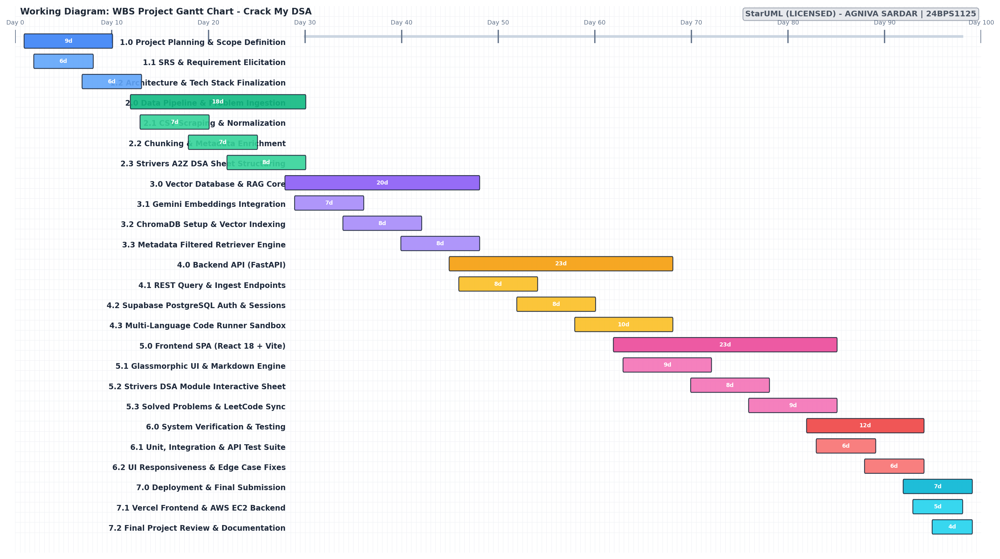

### WBS Task Table
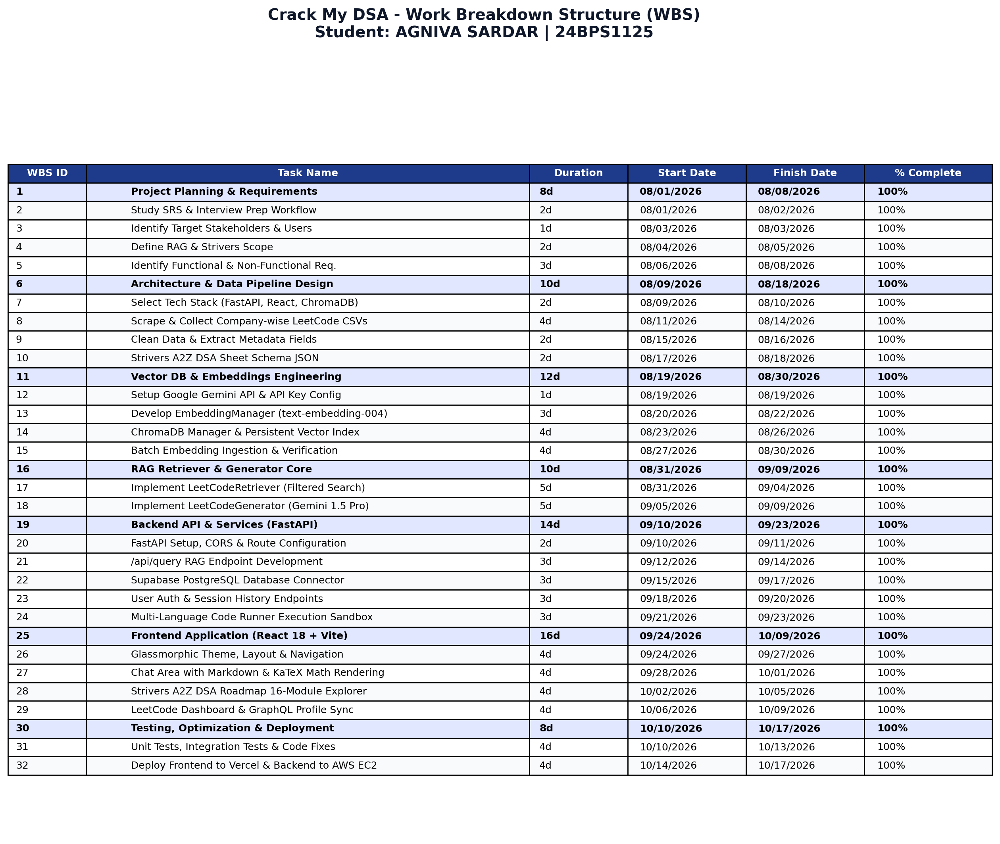

---

# LAB 4
## ER DIAGRAM

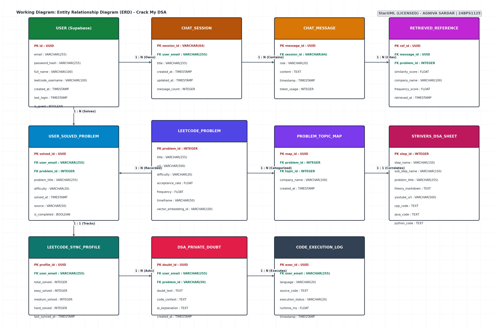

---

# LAB 5
## USE CASE DIAGRAM

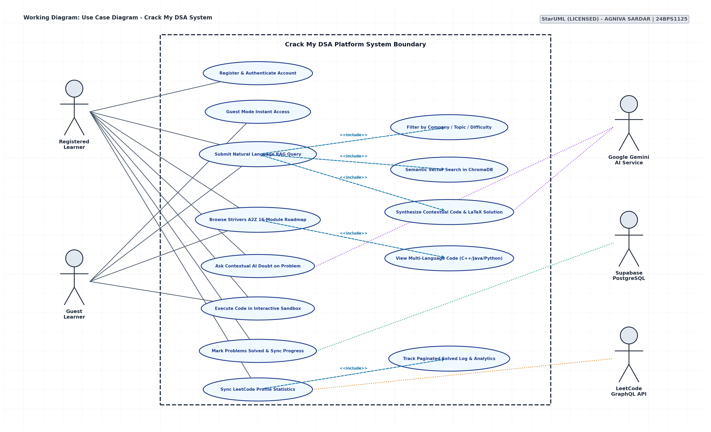

---

# LAB 6
## DATA FLOW DIAGRAMS (DFD)

### DFD Level 0 (Context Diagram)
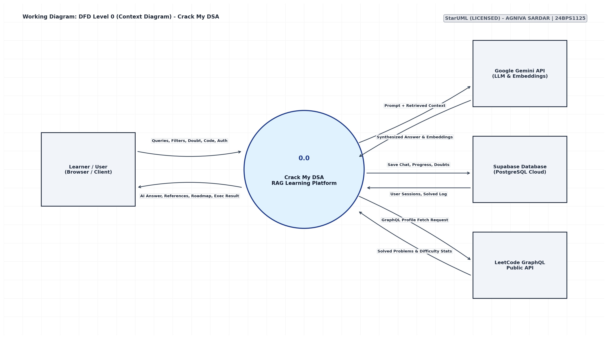

### DFD Level 1
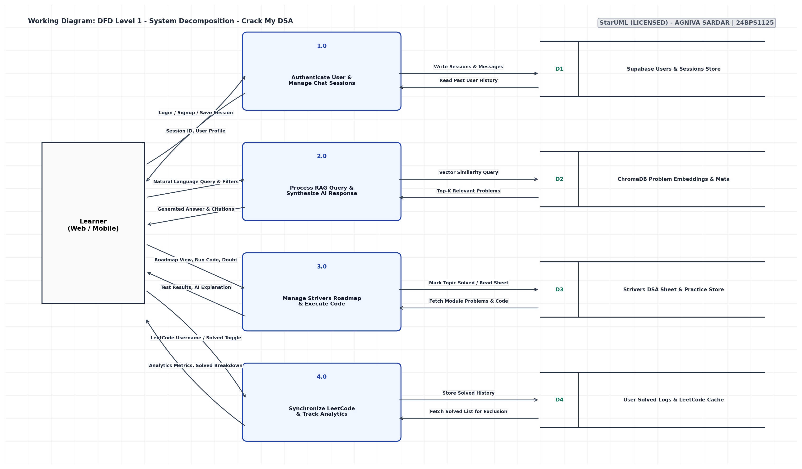

### DFD Level 2
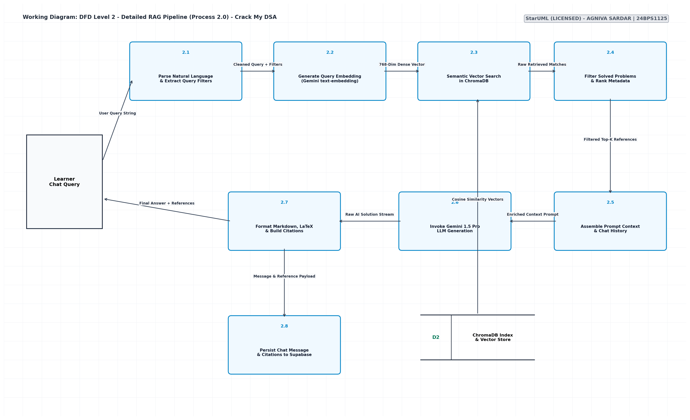

---

# LAB 7
## STATE CHART DIAGRAM

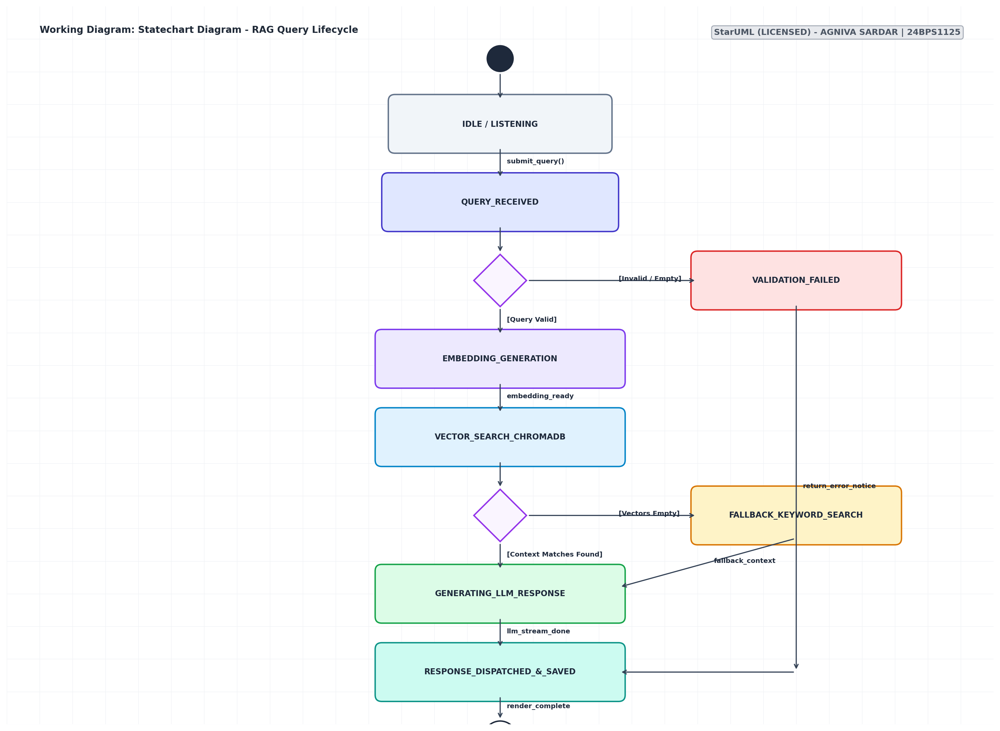

---

# LAB 8
## ACTIVITY DIAGRAM + SEQUENCE DIAGRAM

### Activity Diagram
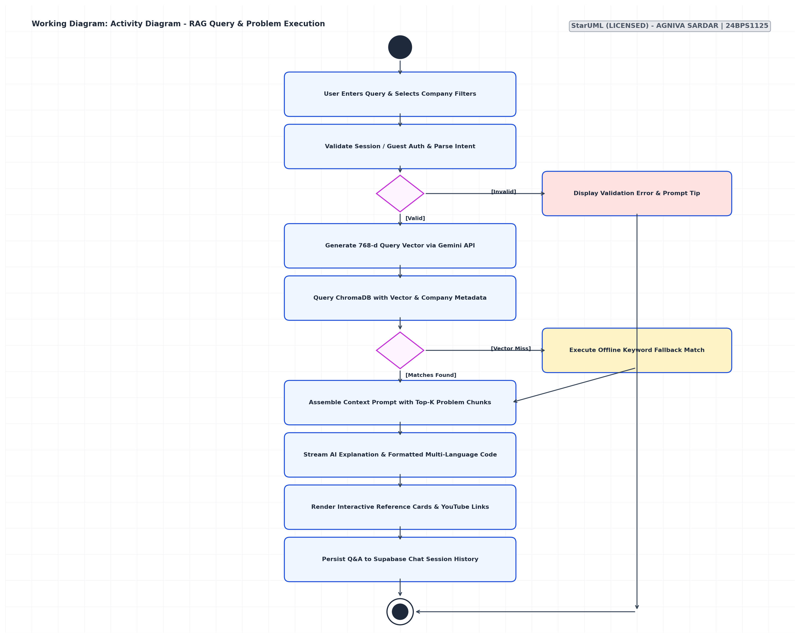

### Sequence Diagram
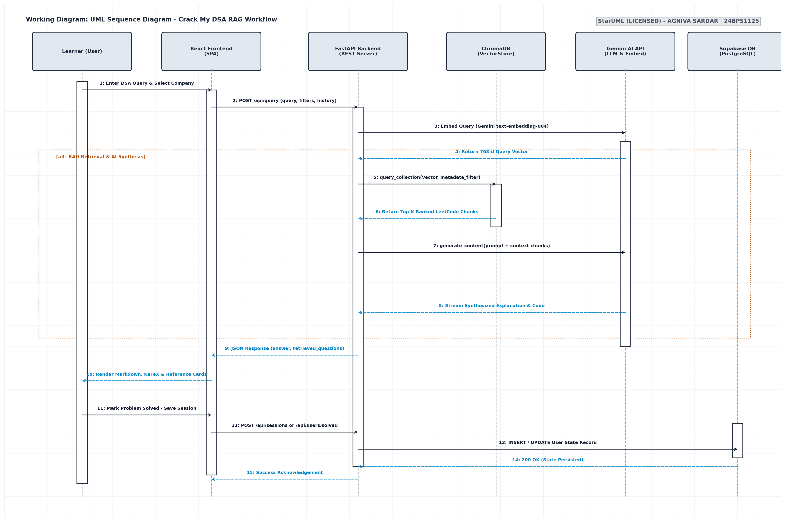

---

# LAB 9
## CLASS DIAGRAM

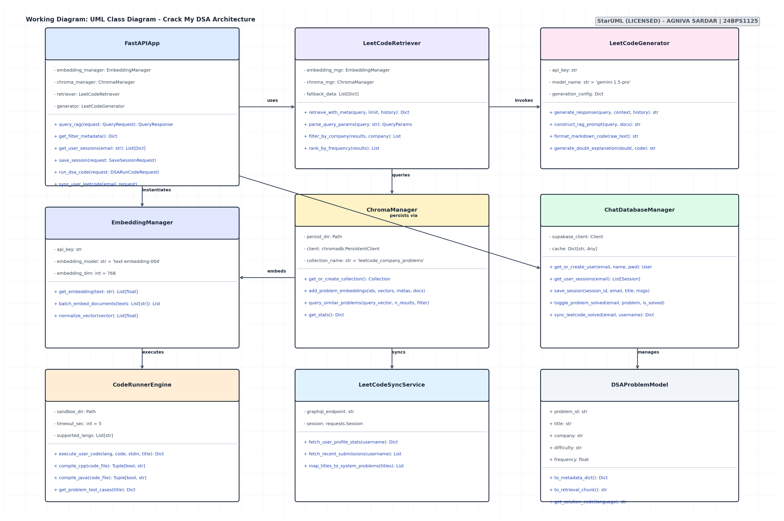

---

# LAB 10
## PACKAGE, COMPONENT AND DEPLOYMENT DIAGRAMS

### Package Diagram
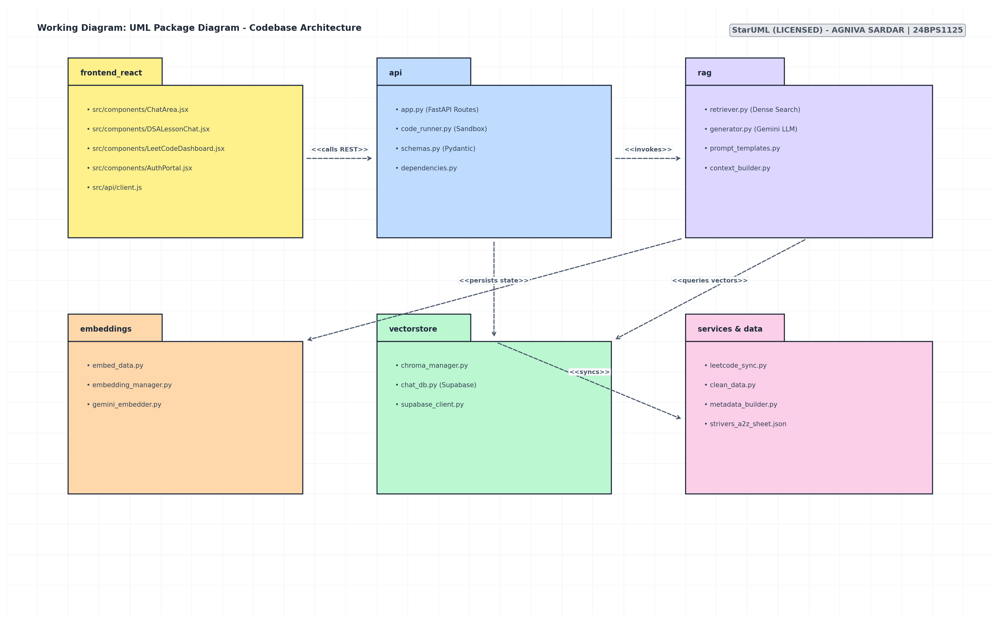

### Component Diagram
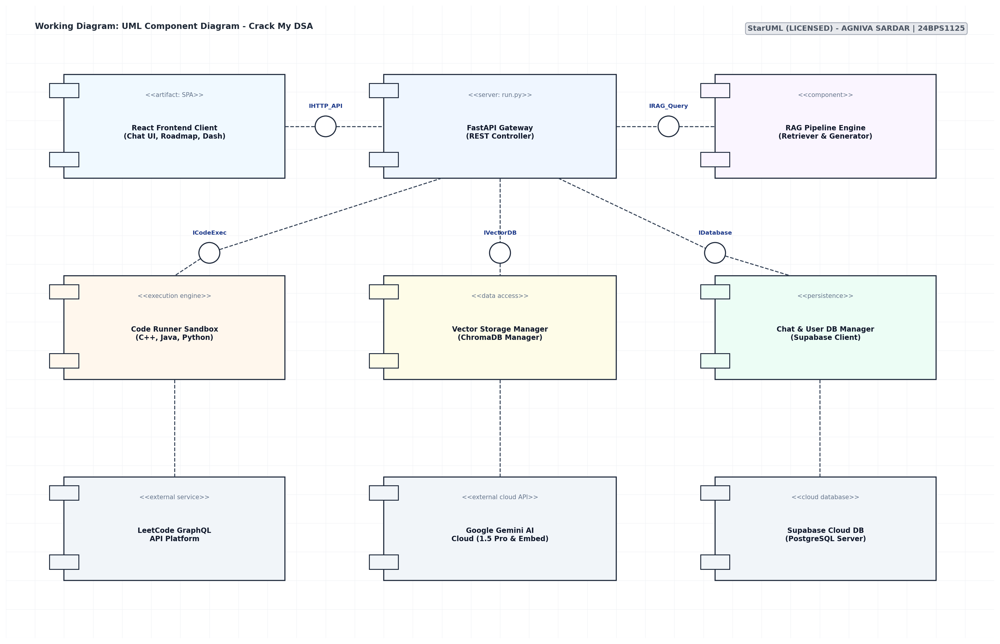

### Deployment Diagram
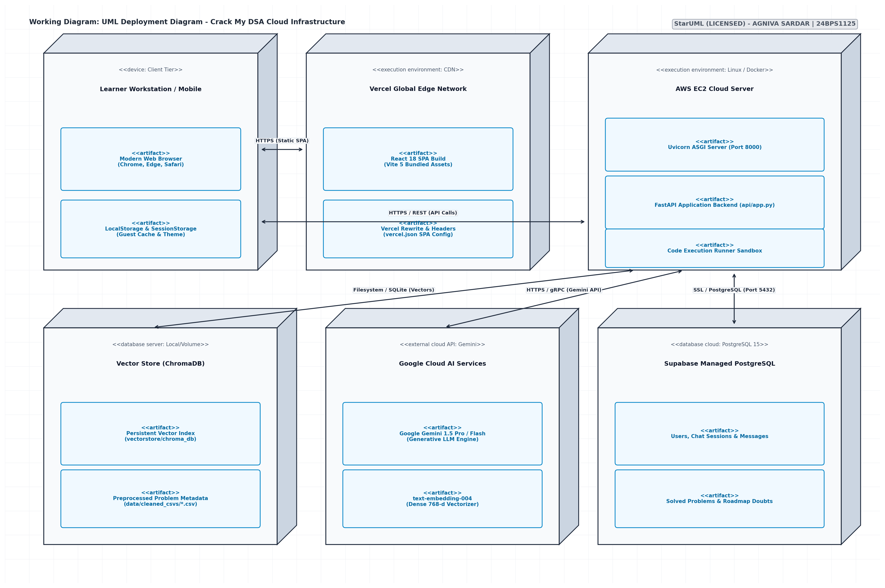

---

# EXPERIMENT 10
## TEST CASES (25)

### 1. Login System
#### Test Case 1
- **Test Case ID:** TC-01-01
- **Description:** To verify that a registered user can successfully log in to the application by entering a valid username and the correct password. This test ensures that the authentication process works properly and authorized users can access their accounts.
- **Positive Input:** Enter a registered username and the corresponding correct password in the login fields.
- **Negative Input:** Not applicable to this positive test case.
- **Expected Result:** The system should validate the entered credentials, authenticate the user, and redirect them to the home page or dashboard. The user should be able to access the features permitted for their account.

#### Test Case 2
- **Test Case ID:** TC-01-02
- **Description:** To verify that the login system rejects users who enter incorrect credentials and applies account lockout rules after repeated failed attempts. This test checks whether unauthorized access is prevented.
- **Positive Input:** Not applicable to this negative test case.
- **Negative Input:** Enter an incorrect password, an unregistered username, or repeatedly submit invalid credentials until the configured failure limit is reached.
- **Expected Result:** The system should deny access and display an appropriate error message. After the permitted number of failed attempts, the account should be locked or temporarily blocked according to the security settings.

---

### 2. User Registration
#### Test Case 1
- **Test Case ID:** TC-02-01
- **Description:** To verify that a new user can create an account by entering all required information correctly. This test checks mandatory fields, email validation, and password requirements during registration.
- **Positive Input:** Enter a unique username, a valid email address, a strong password that meets the specified rules, and all other mandatory details.
- **Negative Input:** Not applicable to this positive test case.
- **Expected Result:** The system should validate all entered details, create the new account successfully, and display a registration confirmation message. If email verification is required, the system should initiate the verification process.

#### Test Case 2
- **Test Case ID:** TC-02-02
- **Description:** To verify that the registration system identifies invalid or incomplete user information before creating an account. This test also checks whether duplicate usernames are prevented.
- **Positive Input:** Not applicable to this negative test case.
- **Negative Input:** Enter an invalid email address, a password that does not satisfy the rules, leave a mandatory field empty, or use a username that already exists.
- **Expected Result:** The system should reject the registration and display clear validation messages for the incorrect fields. No account should be created until all required information is valid and the username is unique.

---

### 3. ATM Cash Withdrawal
#### Test Case 1
- **Test Case ID:** TC-03-01
- **Description:** To verify that a customer can withdraw cash from an ATM using a valid bank card and correct PIN. This test checks whether the ATM processes the requested amount correctly when the customer has sufficient funds.
- **Positive Input:** Insert a valid ATM card, enter the correct PIN, and request an amount that does not exceed the available balance or the permitted withdrawal limit.
- **Negative Input:** Not applicable to this positive test case.
- **Expected Result:** The ATM should approve the transaction, dispense the requested cash, and deduct the amount from the account balance. A receipt or transaction confirmation should be provided, and the updated balance should be accurate.

#### Test Case 2
- **Test Case ID:** TC-03-02
- **Description:** To verify that the ATM prevents withdrawals when the customer provides an incorrect PIN or requests more money than permitted. This test checks transaction validation and account security.
- **Positive Input:** Not applicable to this negative test case.
- **Negative Input:** Enter an incorrect PIN, request an amount greater than the available account balance, or exceed the daily withdrawal limit.
- **Expected Result:** The ATM should reject the transaction, display a suitable error message, and dispense no cash. The account balance should remain unchanged, and repeated incorrect PIN attempts should be handled according to the bank's security rules.

---

### 4. Online Banking Fund Transfer
#### Test Case 1
- **Test Case ID:** TC-04-01
- **Description:** To verify that a bank customer can transfer money successfully to a valid beneficiary account through online banking. This test checks beneficiary validation, available balance, and transaction processing.
- **Positive Input:** Log in to online banking, select a valid beneficiary, enter a transfer amount within the available balance and transaction limit, and confirm the transaction.
- **Negative Input:** Not applicable to this positive test case.
- **Expected Result:** The system should process the transfer successfully, debit the correct amount from the sender's account, and credit the beneficiary's account. A transaction reference and confirmation message should be displayed.

#### Test Case 2
- **Test Case ID:** TC-04-02
- **Description:** To verify that online banking rejects fund transfers when the beneficiary details are invalid or the requested amount exceeds the permitted balance or limit. This test checks whether incorrect transactions are prevented.
- **Positive Input:** Not applicable to this negative test case.
- **Negative Input:** Enter an invalid beneficiary account number, request an amount greater than the available balance, or enter an amount above the transaction limit.
- **Expected Result:** The system should reject the transfer and display a message explaining the problem. No unauthorized debit should occur, and the account balances should remain unchanged.

---

### 5. Online Shopping – Product Search
#### Test Case 1
- **Test Case ID:** TC-05-01
- **Description:** To verify that the shopping application displays relevant products when a customer searches using an exact product name or a partial keyword. This test checks the accuracy and relevance of the search functionality.
- **Positive Input:** Enter the complete name of an existing product or a distinctive keyword, such as a product name or brand, in the search bar.
- **Negative Input:** Not applicable to this positive test case.
- **Expected Result:** The system should display products that match the search query. Exact matches should be easy to identify, and relevant partial matches should also appear when applicable.

#### Test Case 2
- **Test Case ID:** TC-05-02
- **Description:** To verify how the search feature responds when a customer enters a product name that does not exist or uses unusual special characters. This test checks error handling and the stability of the search function.
- **Positive Input:** Not applicable to this negative test case.
- **Negative Input:** Search for a nonexistent product or enter a query containing unsupported or unusual characters.
- **Expected Result:** The system should display a clear message such as “No products found” when there are no matches. Special characters should be handled safely, and the application should not crash or display technical errors.

---

### 6. Shopping Cart
#### Test Case 1
- **Test Case ID:** TC-06-01
- **Description:** To verify that a customer can add available products to the shopping cart, change quantities, and view the updated price. This test checks whether cart operations and price calculations work correctly.
- **Positive Input:** Select an in-stock product, add it to the cart, increase or decrease the quantity within the available stock, and review the displayed total.
- **Negative Input:** Not applicable to this positive test case.
- **Expected Result:** The selected product should appear in the cart with the correct quantity and price. The subtotal, taxes, applicable discounts, and total should be recalculated accurately whenever the quantity changes.

#### Test Case 2
- **Test Case ID:** TC-06-02
- **Description:** To verify that the shopping cart prevents customers from ordering unavailable products or entering invalid quantities. This test also checks whether the cart reflects updated stock and prices.
- **Positive Input:** Not applicable to this negative test case.
- **Negative Input:** Attempt to add an out-of-stock product, enter a negative or zero quantity, or request more units than are available in stock.
- **Expected Result:** The system should prevent invalid cart updates and display a suitable message. The cart should show accurate prices and quantities, and checkout should not proceed with invalid stock information.

---

### 7. Online Payment Gateway
#### Test Case 1
- **Test Case ID:** TC-07-01
- **Description:** To verify that a customer can complete an online payment using valid and unexpired card details. This test checks whether the payment gateway communicates correctly with the payment processor and confirms a successful transaction.
- **Positive Input:** Enter valid card details, the correct billing information, and other required payment details. Use a payment method with sufficient funds and confirm the payment.
- **Negative Input:** Not applicable to this positive test case.
- **Expected Result:** The payment gateway should process the payment successfully and display a confirmation message. The transaction reference should be generated, and the order should be marked as paid only after the payment is confirmed.

#### Test Case 2
- **Test Case ID:** TC-07-02
- **Description:** To verify that the payment gateway correctly handles declined payments, expired cards, and communication timeouts. This test checks whether failed or uncertain transactions are handled without duplicate charges.
- **Positive Input:** Not applicable to this negative test case.
- **Negative Input:** Use a declined card, enter an expired card's details, or simulate a timeout while the payment gateway is processing the transaction.
- **Expected Result:** The system should display the appropriate failure or pending status. It should not mark an unconfirmed transaction as successful, and it should prevent duplicate charges if the customer retries the payment.

---

### 8. Food Delivery Application
#### Test Case 1
- **Test Case ID:** TC-08-01
- **Description:** To verify that a customer can select a restaurant, choose available food items, and place an order using a valid delivery address. This test checks menu availability, minimum order requirements, and order confirmation.
- **Positive Input:** Select a restaurant that delivers to the customer's location, choose available menu items, meet the minimum order amount, and enter a valid delivery address.
- **Negative Input:** Not applicable to this positive test case.
- **Expected Result:** The system should accept the order, calculate the total amount correctly, and display an order ID and estimated delivery time. The order details should include the selected items and delivery address.

#### Test Case 2
- **Test Case ID:** TC-08-02
- **Description:** To verify that the food delivery application prevents checkout when the order contains unavailable items, fails to meet the minimum order amount, or uses an invalid delivery address.
- **Positive Input:** Not applicable to this negative test case.
- **Negative Input:** Select an unavailable menu item, place an order below the minimum required amount, or enter an incomplete or unsupported delivery address.
- **Expected Result:** The system should prevent checkout or request the necessary corrections. It should display a message identifying the issue and should not create an invalid order.

---

### 9. Railway/Bus Ticket Booking
#### Test Case 1
- **Test Case ID:** TC-09-01
- **Description:** To verify that a passenger can book a railway or bus ticket when seats are available for the selected route and travel date. This test checks seat availability, passenger details, and booking confirmation.
- **Positive Input:** Select a valid source and destination, choose a future travel date, select an available seat, and enter all required passenger details.
- **Negative Input:** Not applicable to this positive test case.
- **Expected Result:** The system should complete the booking successfully and generate a ticket with a unique booking reference or PNR. The ticket should display the correct passenger details, route, date, and seat information.

#### Test Case 2
- **Test Case ID:** TC-09-02
- **Description:** To verify that the ticket booking system rejects invalid travel dates, incomplete passenger information, or attempts to reserve seats that are no longer available.
- **Positive Input:** Not applicable to this negative test case.
- **Negative Input:** Select a past travel date, leave mandatory passenger details blank, enter invalid passenger information, or attempt to book an already-occupied seat.
- **Expected Result:** The system should display appropriate validation messages and prevent the invalid booking. No duplicate ticket should be generated, and unavailable seats should not be assigned.

---

### 10. Flight Booking
#### Test Case 1
- **Test Case ID:** TC-10-01
- **Description:** To verify that a customer can search for available flights by providing valid departure and destination locations, travel dates, and passenger details. This test checks the accuracy of flight search and itinerary selection.
- **Positive Input:** Enter a valid source airport, a different destination airport, a future travel date, and a passenger count within the permitted limit.
- **Negative Input:** Not applicable to this positive test case.
- **Expected Result:** The system should display flights matching the entered details, including relevant departure times, fares, and availability. The customer should be able to select a valid itinerary and continue with the booking process.

#### Test Case 2
- **Test Case ID:** TC-10-02
- **Description:** To verify that the flight booking system identifies invalid combinations of travel details before proceeding with a search or booking.
- **Positive Input:** Not applicable to this negative test case.
- **Negative Input:** Enter the same source and destination, select a past travel date, provide an invalid passenger count, or choose an itinerary that violates the system's travel rules.
- **Expected Result:** The system should reject the invalid details and display a clear validation message. It should not allow an invalid itinerary to proceed to booking.

---

### 11. Hotel Reservation
#### Test Case 1
- **Test Case ID:** TC-11-01
- **Description:** To verify that a customer can reserve an available hotel room by entering valid check-in and check-out dates and an acceptable number of guests. This test checks room availability and reservation details.
- **Positive Input:** Select a hotel with available rooms, enter a check-in date earlier than the check-out date, and provide a guest count within the room's permitted capacity.
- **Negative Input:** Not applicable to this positive test case.
- **Expected Result:** The system should confirm the reservation and display the hotel name, room type, dates, guest count, total price, and booking reference. The room should be reserved for the selected period.

#### Test Case 2
- **Test Case ID:** TC-11-02
- **Description:** To verify that the hotel reservation system rejects bookings with invalid date ranges, unavailable rooms, or guest counts exceeding the room's capacity.
- **Positive Input:** Not applicable to this negative test case.
- **Negative Input:** Enter a check-out date that is the same as or earlier than the check-in date, select an unavailable room, or enter more guests than the room permits.
- **Expected Result:** The system should prevent the reservation and display a clear message explaining the problem. No invalid booking should be created, and the customer should be able to correct the details.

---

### 12. Library Management System
#### Test Case 1
- **Test Case ID:** TC-12-01
- **Description:** To verify that a valid library member can borrow an available book and return it successfully. This test checks the issue and return process, due-date assignment, and inventory updates.
- **Positive Input:** Log in using an active library membership, select an available book, issue it within the permitted borrowing limit, and return it through the library system.
- **Negative Input:** Not applicable to this positive test case.
- **Expected Result:** The system should record the book issue, assign a due date, and update the member's borrowing record. When the book is returned, its availability should be updated and the member's loan record should reflect the return.

#### Test Case 2
- **Test Case ID:** TC-12-02
- **Description:** To verify that the library management system prevents book issuance when the member is invalid, the book is unavailable, or the borrowing limit has been reached.
- **Positive Input:** Not applicable to this negative test case.
- **Negative Input:** Attempt to borrow a book using an expired membership, request a book that is already issued, or exceed the maximum number of permitted loans.
- **Expected Result:** The system should reject the issue request and display the appropriate reason. The book inventory and member borrowing records should remain accurate.

---

### 13. Student Attendance System
#### Test Case 1
- **Test Case ID:** TC-13-01
- **Description:** To verify that an authorized teacher or administrator can mark attendance for a valid student during a scheduled class session. This test checks attendance recording and percentage calculation.
- **Positive Input:** Enter a valid student ID, select the correct class and attendance date, choose the attendance status, and save the record.
- **Negative Input:** Not applicable to this positive test case.
- **Expected Result:** The system should save the attendance record successfully and display a confirmation. The student's attendance history and overall attendance percentage should be updated correctly.

#### Test Case 2
- **Test Case ID:** TC-13-02
- **Description:** To verify that the attendance system rejects nonexistent student IDs and prevents the same student from being marked more than once for the same class session.
- **Positive Input:** Not applicable to this negative test case.
- **Negative Input:** Enter an invalid student ID or attempt to submit another attendance record for the same student, date, and session.
- **Expected Result:** The system should display a validation message for an invalid ID and prevent duplicate attendance records. The attendance percentage should not be incorrectly increased by duplicate entries.

---

### 14. Student Mark/Grade System
#### Test Case 1
- **Test Case ID:** TC-14-01
- **Description:** To verify that the student mark and grade system correctly calculates subject totals, overall percentage, and final grades when valid marks are entered. This test checks the calculation against the institution's grading rules.
- **Positive Input:** Enter valid numeric marks within the permitted minimum and maximum range for every required subject.
- **Negative Input:** Not applicable to this positive test case.
- **Expected Result:** The system should calculate the total marks, percentage, and grade accurately. The displayed result should correspond to the configured grading scale.

#### Test Case 2
- **Test Case ID:** TC-14-02
- **Description:** To verify that the system detects marks that fall outside the allowed range or contain invalid characters. This test checks input validation before the results are calculated or saved.
- **Positive Input:** Not applicable to this negative test case.
- **Negative Input:** Enter negative marks, marks greater than the maximum score, or alphabetic characters in a numeric marks field.
- **Expected Result:** The system should reject the invalid values and display appropriate validation messages. Incorrect marks should not be saved or used to generate the student's final grade.

---

### 15. College Course Registration
#### Test Case 1
- **Test Case ID:** TC-15-01
- **Description:** To verify that a student can register for a course when all academic and administrative requirements are satisfied. This test checks prerequisites, seat availability, and timetable compatibility.
- **Positive Input:** Log in using an eligible student account, ensure all prerequisites are completed, select a course with available seats, and confirm that the timetable does not conflict with other registered courses.
- **Negative Input:** Not applicable to this positive test case.
- **Expected Result:** The system should register the student successfully and display the course in the registered-course list. The student's registration record and available seat count should be updated correctly.

#### Test Case 2
- **Test Case ID:** TC-15-02
- **Description:** To verify that the course registration system prevents enrollment when a student does not meet course requirements or when registration would cause a conflict.
- **Positive Input:** Not applicable to this negative test case.
- **Negative Input:** Attempt to register without completing prerequisites, select a course that has reached its capacity, register for the same course twice, or choose a course with an overlapping timetable.
- **Expected Result:** The system should reject the registration and display the reason. It should not create duplicate registrations or permit enrollment in a course for which the student is ineligible.

---

### 16. Online Examination System
#### Test Case 1
- **Test Case ID:** TC-16-01
- **Description:** To verify that a student can log in to an online examination, navigate between questions, save answers, and submit the examination before the allotted time expires.
- **Positive Input:** Enter valid examination login credentials, open the assigned examination, answer multiple questions, navigate between questions, and submit before the timer reaches zero.
- **Negative Input:** Not applicable to this positive test case.
- **Expected Result:** The system should allow access to the examination, preserve the student's answers during navigation, and submit the attempt successfully. A submission confirmation should be displayed.

#### Test Case 2
- **Test Case ID:** TC-16-02
- **Description:** To verify that the examination system handles incorrect login credentials and automatically manages the examination when the allotted time expires.
- **Positive Input:** Not applicable to this negative test case.
- **Negative Input:** Enter invalid login credentials or allow the examination timer to expire without manually submitting the answers.
- **Expected Result:** Invalid credentials should prevent examination access. When the timer expires, the system should automatically submit or close the attempt according to the examination rules and prevent further answer changes.

---

### 17. Employee Payroll System
#### Test Case 1
- **Test Case ID:** TC-17-01
- **Description:** To verify that the payroll system calculates an employee's salary correctly by considering basic pay, overtime earnings, applicable deductions, and leave-related adjustments.
- **Positive Input:** Enter a valid employee record with the correct basic salary, approved overtime hours, applicable tax and benefit deductions, and approved leave information.
- **Negative Input:** Not applicable to this positive test case.
- **Expected Result:** The system should calculate gross salary, total deductions, and net salary accurately according to company payroll policies. The generated payroll statement should show the correct earnings and deductions.

#### Test Case 2
- **Test Case ID:** TC-17-02
- **Description:** To verify that the payroll system identifies invalid salary information, overtime values, or deduction entries before processing an employee's payroll.
- **Positive Input:** Not applicable to this negative test case.
- **Negative Input:** Enter a negative basic salary, invalid overtime hours, negative deductions, or inconsistent leave information.
- **Expected Result:** The system should identify invalid entries and display suitable validation messages. Payroll should not be finalized using incorrect data, and unsupported deductions should not be applied.

---

### 18. Leave Management System
#### Test Case 1
- **Test Case ID:** TC-18-01
- **Description:** To verify that an employee can submit a valid leave request when sufficient leave balance is available. This test checks date validation, leave balance, and the approval workflow.
- **Positive Input:** Log in with a valid employee account, select a valid future date range, ensure sufficient leave balance is available, and submit the request without overlapping existing leave.
- **Negative Input:** Not applicable to this positive test case.
- **Expected Result:** The system should record the request and forward it to the appropriate manager for approval. The employee should be able to view the request status, and the leave balance should be updated according to the system's rules.

#### Test Case 2
- **Test Case ID:** TC-18-02
- **Description:** To verify that the leave management system rejects requests containing invalid dates, insufficient leave balance, or overlapping leave periods.
- **Positive Input:** Not applicable to this negative test case.
- **Negative Input:** Request more leave than the available balance, enter an end date earlier than the start date, or select dates that overlap an existing approved or pending request.
- **Expected Result:** The system should reject or flag the invalid request and display an appropriate message. The leave balance should remain accurate, and conflicting requests should not be approved automatically.

---

### 19. Hospital Appointment System
#### Test Case 1
- **Test Case ID:** TC-19-01
- **Description:** To verify that a patient can book an appointment with an available doctor by providing valid patient information and selecting an open appointment slot.
- **Positive Input:** Enter valid patient details, select an available doctor and appointment date, choose an open time slot, and confirm the booking.
- **Negative Input:** Not applicable to this positive test case.
- **Expected Result:** The system should create the appointment successfully and display the doctor, appointment date, time, and booking reference. A confirmation notification should be sent if the system supports it.

#### Test Case 2
- **Test Case ID:** TC-19-02
- **Description:** To verify that the appointment system prevents patients from booking unavailable slots or creating duplicate appointments for the same time.
- **Positive Input:** Not applicable to this negative test case.
- **Negative Input:** Select an already-booked time slot, submit the same appointment request twice, or provide incomplete mandatory patient details.
- **Expected Result:** The system should reject the invalid or duplicate booking and display a suitable message. The existing appointment should remain unchanged, and the patient should be prompted to select an available slot if necessary.

---

### 20. Pharmacy/Medicine Ordering System
#### Test Case 1
- **Test Case ID:** TC-20-01
- **Description:** To verify that a customer can order an available medicine by entering a valid quantity and providing the required prescription when applicable.
- **Positive Input:** Select a medicine that is in stock, enter a quantity within the permitted limit, provide a valid prescription for prescription-only medicine, and proceed with checkout.
- **Negative Input:** Not applicable to this positive test case.
- **Expected Result:** The system should accept the order and display the order details and confirmation. Prescription-dependent orders should proceed only according to the required verification process.

#### Test Case 2
- **Test Case ID:** TC-20-02
- **Description:** To verify that the medicine ordering system prevents orders that violate stock availability, quantity limits, or prescription requirements.
- **Positive Input:** Not applicable to this negative test case.
- **Negative Input:** Select an out-of-stock medicine, request more than the permitted quantity, or attempt to order prescription-only medicine without a valid prescription.
- **Expected Result:** The system should block the invalid order or hold it for the required verification. An appropriate message should explain the problem, and the order should not be incorrectly confirmed.

---

### 21. Email Application
#### Test Case 1
- **Test Case ID:** TC-21-01
- **Description:** To verify that an authenticated user can compose and send an email with a valid recipient address, subject, and message body. This test checks the basic email-sending functionality.
- **Positive Input:** Log in using valid credentials, enter a valid recipient email address, provide a subject and message body, and click the Send button.
- **Negative Input:** Not applicable to this positive test case.
- **Expected Result:** The email should be sent successfully and appear in the Sent Items folder. The recipient address, subject, and message content should match the information entered by the user.

#### Test Case 2
- **Test Case ID:** TC-21-02
- **Description:** To verify that the email application validates recipient addresses and attachment requirements before sending a message. It also checks how the system handles an empty subject when subject validation is configured.
- **Positive Input:** Not applicable to this negative test case.
- **Negative Input:** Enter a malformed recipient address, attach a file that exceeds the size limit or is unsupported, or leave the subject blank when a subject is mandatory.
- **Expected Result:** The system should display appropriate validation warnings and prevent sending when a blocking error exists. If an empty subject is allowed, the application should follow its configured behavior rather than incorrectly rejecting the email.

---

### 22. Password Reset System
#### Test Case 1
- **Test Case ID:** TC-22-01
- **Description:** To verify that a registered user can reset their password by entering their registered email address, providing a valid OTP, and creating a password that meets the security requirements.
- **Positive Input:** Enter a registered email address, request a password reset, provide the correct unexpired OTP, and enter a new password that satisfies all password rules.
- **Negative Input:** Not applicable to this positive test case.
- **Expected Result:** The system should verify the OTP, update the password successfully, and display a confirmation message. The old password should no longer provide access to the account.

#### Test Case 2
- **Test Case ID:** TC-22-02
- **Description:** To verify that the password reset system rejects requests containing invalid email details, an incorrect or expired OTP, or a password that does not meet the required security rules.
- **Positive Input:** Not applicable to this negative test case.
- **Negative Input:** Use an unregistered email address, enter an incorrect or expired OTP, or provide a weak password that violates the configured policy.
- **Expected Result:** The system should reject the password reset and display an appropriate message. The existing password should remain unchanged, and the user should be required to complete the verification process correctly.

---

### 23. Mobile Recharge System
#### Test Case 1
- **Test Case ID:** TC-23-01
- **Description:** To verify that a customer can recharge a valid mobile number by selecting the correct telecom operator and a supported recharge plan. This test checks the recharge process and transaction confirmation.
- **Positive Input:** Enter a valid mobile number, select the matching operator, choose a supported recharge amount or plan, and complete payment successfully.
- **Negative Input:** Not applicable to this positive test case.
- **Expected Result:** The system should process the recharge request successfully and display a transaction reference and recharge status. The selected mobile number, operator, and recharge amount should be recorded correctly.

#### Test Case 2
- **Test Case ID:** TC-23-02
- **Description:** To verify that the recharge system handles invalid mobile numbers, incorrect operator selections, unsupported recharge amounts, and payment failures appropriately.
- **Positive Input:** Not applicable to this negative test case.
- **Negative Input:** Enter a malformed mobile number, select an incorrect operator, choose an unsupported recharge plan, or simulate a failed payment transaction.
- **Expected Result:** The system should reject invalid details and display a suitable message. A failed transaction should not be marked as successful, and the user should receive appropriate status, retry, or refund information where applicable.

---

### 24. Bank Loan Eligibility System
#### Test Case 1
- **Test Case ID:** TC-24-01
- **Description:** To verify that the loan eligibility system evaluates an applicant who satisfies the configured age, income, credit score, and requested loan amount requirements.
- **Positive Input:** Enter a valid age within the permitted range, sufficient income, an acceptable credit score, and a loan amount within the allowed limits.
- **Negative Input:** Not applicable to this positive test case.
- **Expected Result:** The system should evaluate the application according to the configured eligibility rules and display the appropriate eligibility status. If the applicant qualifies, the system should provide the next steps in the loan application process.

#### Test Case 2
- **Test Case ID:** TC-24-02
- **Description:** To verify that the loan eligibility system identifies applicants who do not satisfy one or more eligibility requirements and prevents incorrect eligibility decisions.
- **Positive Input:** Not applicable to this negative test case.
- **Negative Input:** Enter an age outside the permitted range, income below the required threshold, a credit score below the configured minimum, or a loan amount exceeding the allowed limit.
- **Expected Result:** The system should mark the application as ineligible or request correction when the input itself is invalid. Where permitted, it should explain the reason for ineligibility and should not incorrectly approve an application that fails the configured rules.

---

### 25. Parking Management System
#### Test Case 1
- **Test Case ID:** TC-25-01
- **Description:** To verify that the parking management system records vehicle entry and exit correctly and calculates the parking fee according to the applicable tariff. This test also checks whether parking spaces are allocated and released accurately.
- **Positive Input:** Enter a valid vehicle registration number, assign an available parking slot, record the vehicle's entry time, and record its exit time when it leaves.
- **Negative Input:** Not applicable to this positive test case.
- **Expected Result:** The system should record the entry and exit details, allocate the parking slot during the stay, and release it after exit. The parking fee should be calculated correctly based on the recorded duration and configured rates.

#### Test Case 2
- **Test Case ID:** TC-25-02
- **Description:** To verify that the parking management system prevents duplicate vehicle entries and invalid parking operations, including entry when all spaces are occupied and exit without a matching entry record.
- **Positive Input:** Not applicable to this negative test case.
- **Negative Input:** Attempt to enter the same vehicle twice without recording an exit, enter when no parking slots are available, or record an exit for a vehicle that has no active parking entry.
- **Expected Result:** The system should reject invalid operations and display an appropriate error message. It should maintain accurate vehicle records, parking slot availability, and fee calculations without creating duplicate or inconsistent transactions.
